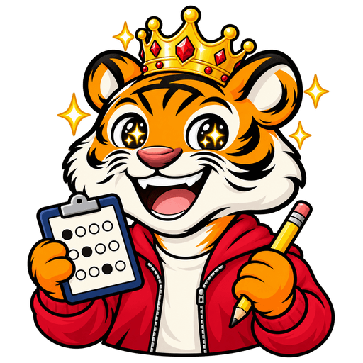
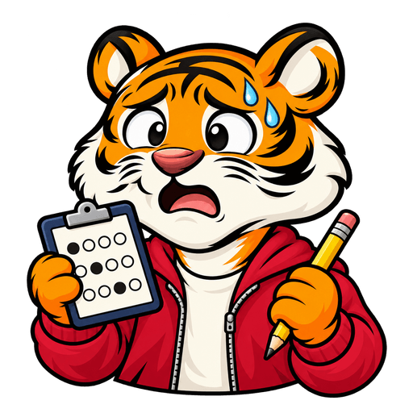

# ACT tiger asset set

Eight transparent 512 × 512 PNGs in `public/tigers/act/tiger_face_01.png` through `tiger_face_08.png`. Created with the built-in image-generation tool. Each variant uses the ACT default expression as its identity reference and the matching SAT expression only as an emotion guide. Exports preserve alpha and are resized with Sharp.

Red hoodie, cream T-shirt, navy answer-sheet clipboard and yellow pencil. Shoulder/waist-up framing matches the approved family style.

| 1 Mastery | 2 Celebration | 3 Default | 4 Encouraging |
| --- | --- | --- | --- |
|  |  |  |  |

| 5 Unsure | 6 Disappointed | 7 Determined | 8 Worried |
| --- | --- | --- | --- |
|  |  |  |  |

## Integration

ACT is registered in `lib/tigerAssets.ts`. Existing shared consumers select the ACT set for the landing page, catalog, v2 header, dashboard, results, drills and OG card.

## Final prompts

## Expression 3

```text
Use case: identity-preserve. Create the ACT college entrance exam version of the supplied TigerTest mascot. The reference is the exact character and illustration style to preserve: natural round orange tiger head, cream muzzle and cheeks, two correct ears, glossy black eyes, reddish brown nose, clean bold black outlines and subtle glossy shading. Keep the same friendly open-mouth smile (default expression 3), shoulder/waist-up framing and large head. Change the outfit to a crimson-red zip hoodie over a cream T-shirt, no hood on head. Change props: one paw holds a compact navy clipboard with a cream multiple-choice answer sheet, represented only by 3 neat rows of four circles with one filled circle per row, no letters or numbers; the other paw holds a yellow pencil with pink eraser. Only two paws. No calculator, varsity jacket, logos, letters, text, graduation cap, crown or confetti. Center one tiger on a square with TRUE transparent alpha background. Keep all ears, paws, props and body silhouette fully inside the frame with at least 5% clear padding on every side. No checkerboard, backdrop, ground shadow, watermark, extra limbs or distorted anatomy. Match the existing TigerTest family exactly.
```

## Expression 1

```text
undefined
```

## Expression 2

```text
undefined
```

## Expression 4

```text
undefined
```

## Expression 5

```text
undefined
```

## Expression 6

```text
undefined
```

## Expression 7

```text
undefined
```

## Expression 8

```text
undefined
```
