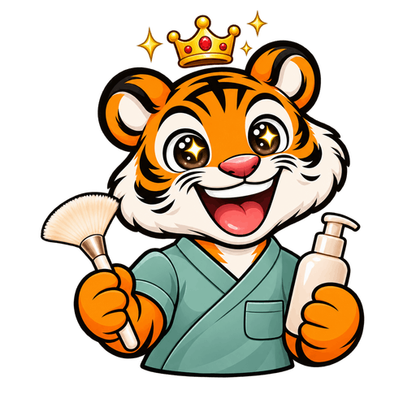
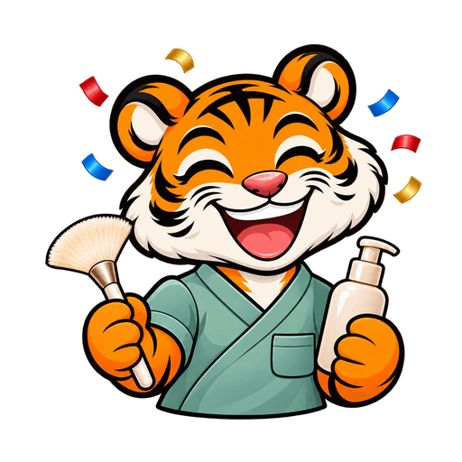
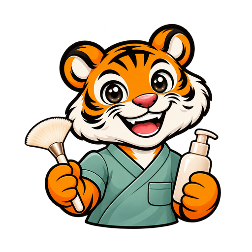
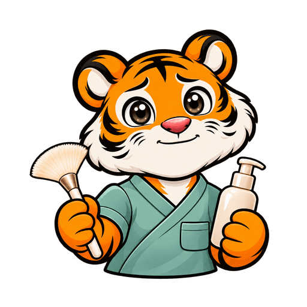
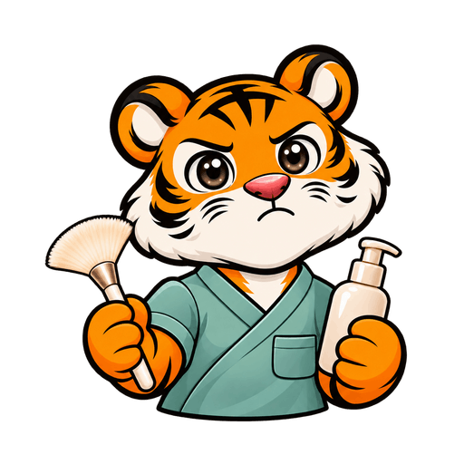
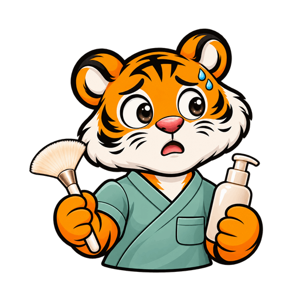

# Esthetics mascot

Dedicated skincare art for the `esthetician` exam, replacing its borrowed cosmetology mascot. The reviewed eight-expression set is `public/tigers/esthetics/`. Other exams and question content are unchanged.

## Generation

Built-in image generation was used, not the API/CLI. The cosmetology default tiger was the character/style reference only. Base prompt: preserve the orange and cream Tigertest identity, rounded head, two ears, glossy eyes, stripes, thick outlines and polished cartoon shading. Dress the tiger in a sage/teal skincare smock, holding a soft facial applicator fan brush and compact moisturizer pump bottle. No comb, scissors, text or logos. Center the complete chest-up character with clear margins on true transparent alpha.

Each of the seven variants was a separate identity-preserving edit of the happy base, not a chain of edits. Preserve clothing, props, paws, pose, colors and framing. Change only the facial features and specified emotion accessories.

| Slot | Expression |
| --- | --- |
| 01 | Mastery: joyful open smile, starry eyes, small gold crown and sparkles |
| 02 | Celebration: laughing open smile, happy eyes and confetti, no crown |
| 03 | Default: friendly open smile and open eyes |
| 04 | Encouraging: confident closed smile, open eyes and relaxed brows |
| 05 | Unsure: small tentative closed smile, open eyes, raised inner brows; no teeth, tongue or sweat |
| 06 | Disappointed: small straight closed mouth, open eyes, raised inner brows |
| 07 | Determined: small closed frown, open eyes, inward brows; no bared teeth |
| 08 | Worried: small open mouth, side-looking eyes and two blue sweat drops |

## Export and review

Resized the generated alpha images to 512 x 512 and optimized as palette PNGs preserving decoded RGBA transparency. All exports are below 100,000 bytes. Reviewed the final exports together: stable outfit/props, complete margins, distinct eight expressions, and slot 05 has the correct hesitant closed smile and open eyes. Hash fixtures pin the reviewed files; tests cover alpha, dimensions, byte budget, mapping, score boundaries and the targeted share-card cache version.

