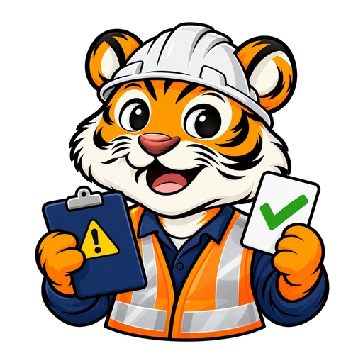
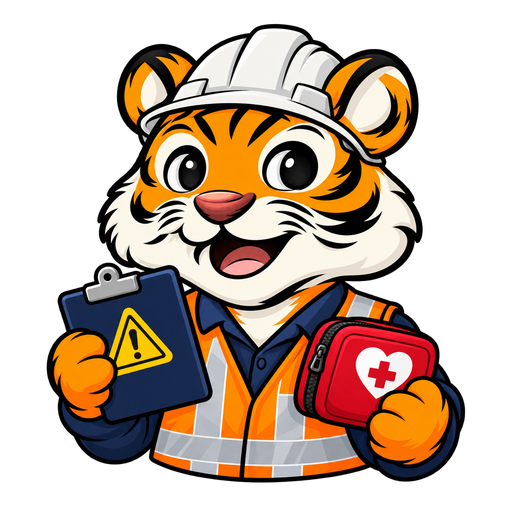
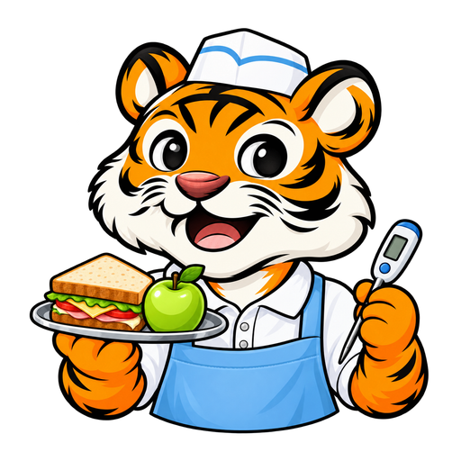
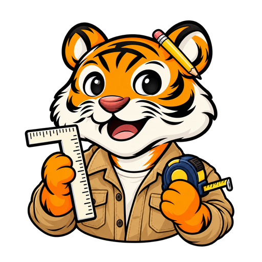
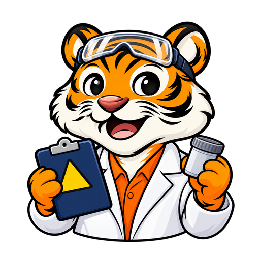
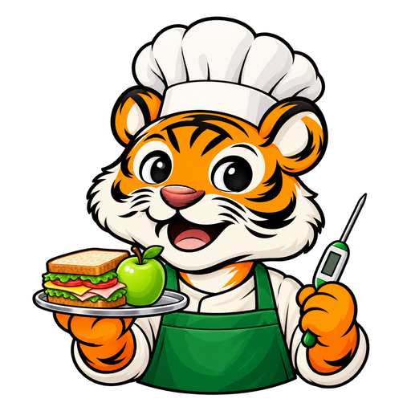
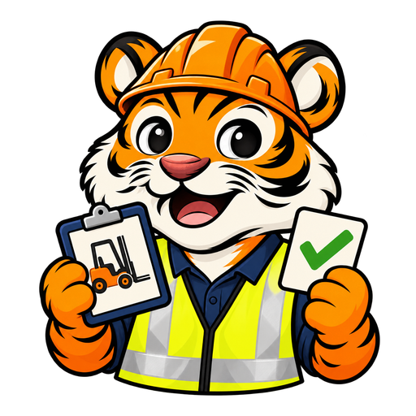

# UK, Canada and Australia tiger artwork

Adds exam-specific art for all 40 tests introduced by PRs #568 and #569. Each set has eight 512 × 512 transparent RGBA PNGs under `public/tigers/<examId>/tiger_face_01.png` through `08.png`.

Every expression was generated separately with the built-in image generation tool, preserving the exam's happy mascot identity, costume and props. Each set received visual review and technical checks for dimensions, actual alpha, clear transparent edges, distinct image pixels, and hashes matching its recorded approval. Additional independent reviews covered all 40 sets across the delivery and root agents.

The sequence retains the app's existing score and dashboard behavior:

| Suffix | Expression | Result score |
|---|---|---|
| 01 | Crowned winner | 100% |
| 02 | Celebrating with confetti | 85–99% |
| 03 | Happy open smile / default | 70–84% |
| 04 | Confident closed smile | 55–69% |
| 05 | Tentative closed smile | 40–54% |
| 06 | Flat closed neutral mouth | 25–39% |
| 07 | Downturned closed frown | 10–24% |
| 08 | Worried open mouth with sweat | 0–9% |

All 40 registry IDs are registered in `lib/tigerAssets.ts`. Their old borrowed-set entries are removed so their own artwork is selected in headers, navigation, landing pages, dashboards, training, results and generated social images. International driving exams retain their existing borrowed artwork. No question banks, pass marks or score thresholds change.

## Included sets

| Country | Exam | Registry ID | Happy preview |
|---|---|---|---|
| UK | KS2 SATs | `ks2` |  |
| UK | GCSE Maths Foundation | `gcsemaths` |  |
| UK | SIA Door Supervisor | `uksia` |  |
| UK | 18th Edition Wiring | `uk18ed` |  |
| CA | OSSLT | `osslt` |  |
| CA | PAL / CFSC | `capal` |  |
| CA | Red Seal Construction Electrician | `caelec` |  |
| AU | NAPLAN Year 9 | `naplan` |  |
| AU | NSW Selective | `nswsel` |  |
| AU | White Card | `auwhite` |  |
| UK | GCSE Maths Higher | `gcsehigher` |  |
| UK | GCSE Combined Science Foundation | `gcsescience` |  |
| UK | GCSE Computer Science | `gcsecs` |  |
| UK | 11+ | `elevenplus` |  |
| UK | Functional Skills Maths L2 | `fsmaths` |  |
| UK | CSCS HS&E | `cscs` |  |
| UK | Level 2 Food Hygiene | `ukfood` |  |
| UK | APLH | `ukaplh` |  |
| UK | First Aid at Work | `ukfaw` |  |
| UK | Care Certificate | `ukcare` |  |
| CA | Red Seal Automotive | `caauto` |  |
| CA | Red Seal Plumber | `caplumb` |  |
| CA | Red Seal Carpenter | `cacarp` |  |
| CA | Red Seal Welder | `caweld` |  |
| CA | Ontario PSW | `capsw` |  |
| CA | REx-PN | `rexpn` |  |
| CA | WHMIS | `cawhmis` |  |
| CA | Ontario Security Guard | `caguard` |  |
| CA | Standard First Aid | `casfa` |  |
| CA | EQAO Grade 9 Math | `eqao9` |  |
| AU | NAPLAN Year 7 | `naplan7` |  |
| AU | NSW Opportunity Class | `ocnsw` |  |
| AU | Victorian Selective | `vicsel` |  |
| AU | HSC Maths Standard 2 | `hscmaths` |  |
| AU | RSA | `aursa` |  |
| AU | RCG | `aurcg` |  |
| AU | Food Safety Supervisor | `aufss` |  |
| AU | First Aid HLTAID011 | `aufirstaid` |  |
| AU | Forklift HRWL | `auforklift` |  |
| AU | Working at Heights | `auwah` |  |
