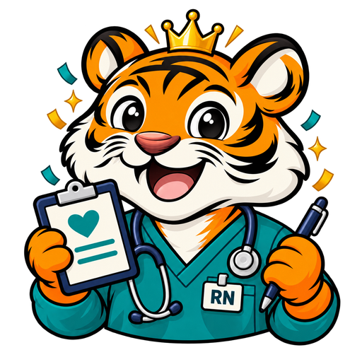
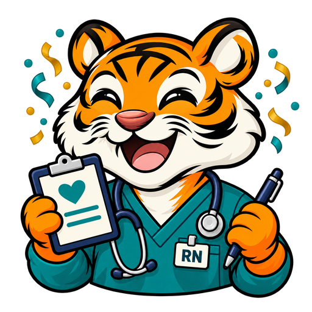
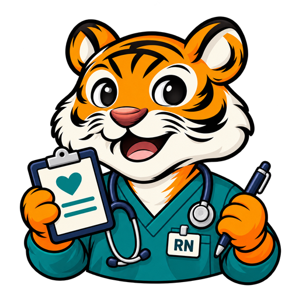
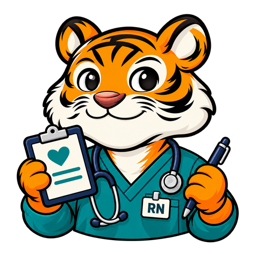
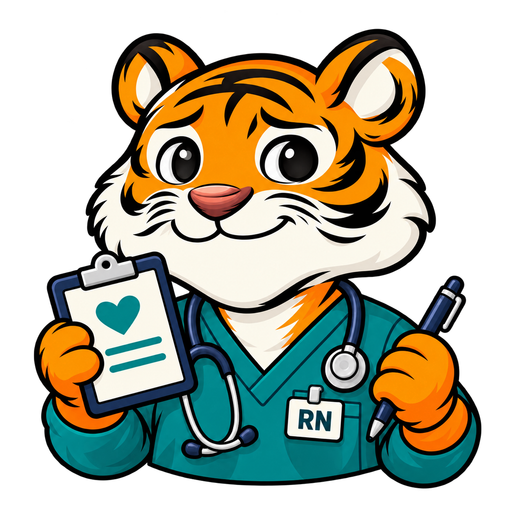
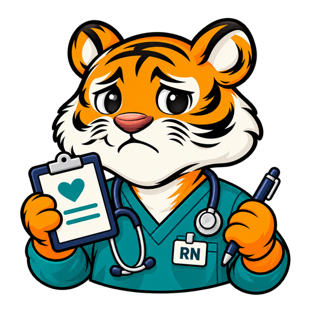
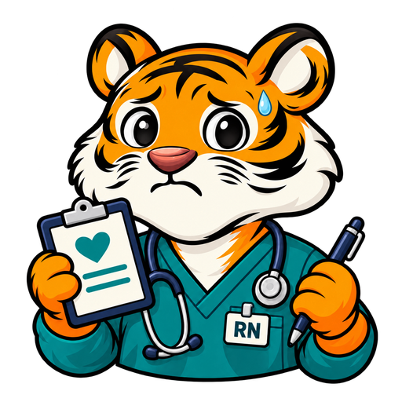

# NCLEX-RN tiger asset set

Eight reviewed, transparent 512 × 512 PNGs in `public/tigers/nclex/`, using the exam's registry ID `nclex`. The default mascot is expression 03.

The established TigerTest character wears teal nursing scrubs, an RN badge and a stethoscope, with a medical clipboard and pen. Head shape, framing, clothing and props remain consistent across expressions.

| 01 Crowned winner | 02 Celebrating | 03 Happy / default | 04 Confident smile |
| --- | --- | --- | --- |
|  |  |  |  |

| 05 Tentative smile | 06 Neutral | 07 Frowning | 08 Worried |
| --- | --- | --- | --- |
|  |  |  |  |

## Integration

`nclex` is registered in `TIGER_EXAM_IDS` in `lib/tigerAssets.ts`. Shared consumers select this artwork for the catalog, test picker, v2 header, dashboard, results, drills, landing page and social cards. Existing Next.js output tracing includes the PNGs.

## Generation and validation

Created with the built-in image-generation tool. Expression 03 uses the existing ACT mascot as the character reference. Each remaining expression is a separate edit of the NCLEX-RN default. Production exports were resized with Sharp while preserving alpha. All eight images passed visual review and dimension, transparency and clear-border checks.

## Final prompts

### Expression 01: Crowned winner

```text
Use case: identity-preserve. Edit the supplied NCLEX-RN TigerTest mascot into expression 01. The input is the exact identity and composition master. Preserve the same natural round orange head, normal forehead shape, exact stripe locations, two ears, cream cheeks and muzzle, glossy black eyes, reddish-brown nose, polished bold-outline cartoon style, deep teal scrubs, navy/silver stethoscope, white badge reading exactly 'RN', navy clipboard with one teal heart and TWO teal horizontal lines, navy pen, two paws, their positions and the compact shoulder/chest-up framing. Keep the body, outfit, props, head scale, and pose unchanged. Change only the expression and any explicitly requested celebration accessory. Crowned winner: joyful open-mouth grin, warmly delighted bright eyes and slightly raised eyebrows. Add a small gold three-point crown centered above the normal unaltered forehead between the ears, with comfortable clear space around it. Add just a few small teal and gold confetti pieces around the upper sides, kept inside the frame. Do not elongate the forehead or stretch the head to attach the crown. One centered standalone mascot on a square canvas with true transparent alpha background. Keep complete ears, all paws, props and requested accessories inside the canvas with at least 6% clear padding. No additional text, watermark, background color, checkerboard pixels, floor or ground shadow. No extra limbs, deformed head or missing equipment. Preserve the supplied image's character exactly.
```

### Expression 02: Celebrating

```text
Use case: identity-preserve. Edit the supplied NCLEX-RN TigerTest mascot into expression 02. The input is the exact identity and composition master. Preserve the same natural round orange head, normal forehead shape, exact stripe locations, two ears, cream cheeks and muzzle, glossy black eyes, reddish-brown nose, polished bold-outline cartoon style, deep teal scrubs, navy/silver stethoscope, white badge reading exactly 'RN', navy clipboard with one teal heart and TWO teal horizontal lines, navy pen, two paws, their positions and the compact shoulder/chest-up framing. Keep the body, outfit, props, head scale, and pose unchanged. Change only the expression and any explicitly requested celebration accessory. Celebrating: an exuberant open-mouth smile, cheerful crescent eyes with brows raised. Add a restrained scattering of small teal and gold confetti around the upper sides. No crown. Keep both paws in their original clipboard-and-pen pose. One centered standalone mascot on a square canvas with true transparent alpha background. Keep complete ears, all paws, props and requested accessories inside the canvas with at least 6% clear padding. No additional text, watermark, background color, checkerboard pixels, floor or ground shadow. No extra limbs, deformed head or missing equipment. Preserve the supplied image's character exactly.
```

### Expression 03: Happy / default

```text
Use case: identity-preserve. Asset type: TigerTest NCLEX-RN nursing exam mascot, default happy expression 03, one standalone production illustration. Image 1 is the exact TigerTest character and visual style reference, not an exam costume to copy. Preserve that tiger's natural round head, normal forehead, symmetrical two ears, orange fur, exact bold black stripe language, cream muzzle and cheek tufts, reddish-brown nose, big glossy black eyes, bold clean black outlines and crisp polished cartoon shading. Keep a friendly open-mouth happy smile. Change the clothing to deep teal V-neck nursing scrubs and put a navy stethoscope with silver chestpiece naturally around the neck. Add one small neat white badge that reads exactly 'RN'. One paw holds a compact navy medical clipboard with an ivory sheet bearing only a simple teal heart symbol and two short teal horizontal lines. The other paw holds one slim navy pen. Exactly two paws. No hoodie, pencil, bubble answer sheet, doctor coat, surgical cap, mask, old-fashioned nurse hat, medical cross, crown or confetti. Composition: centered head-dominant shoulder/chest-up mascot, compact shoulders, head about two-thirds of total subject height; no abdomen, waist, legs or tail. Keep BOTH complete ears, all cheek tufts, both paws and all props fully inside the square canvas with at least 7% clear margin on every side. Genuinely transparent alpha background. No backdrop, checkerboard drawn into pixels, text apart from RN, watermark, floor, ground shadow, extra limbs, malformed skull or distorted face. Match the supplied TigerTest family closely.
```

### Expression 04: Confident smile

```text
Use case: identity-preserve. Edit the supplied NCLEX-RN TigerTest mascot into expression 04. The input is the exact identity and composition master. Preserve the same natural round orange head, normal forehead shape, exact stripe locations, two ears, cream cheeks and muzzle, glossy black eyes, reddish-brown nose, polished bold-outline cartoon style, deep teal scrubs, navy/silver stethoscope, white badge reading exactly 'RN', navy clipboard with one teal heart and TWO teal horizontal lines, navy pen, two paws, their positions and the compact shoulder/chest-up framing. Keep the body, outfit, props, head scale, and pose unchanged. Change only the expression and any explicitly requested celebration accessory. Confident smile: calm encouraging expression, gently upturned CLOSED mouth, relaxed open eyes and softly confident brows. No crown, no confetti, no sweat. One centered standalone mascot on a square canvas with true transparent alpha background. Keep complete ears, all paws, props and requested accessories inside the canvas with at least 6% clear padding. No additional text, watermark, background color, checkerboard pixels, floor or ground shadow. No extra limbs, deformed head or missing equipment. Preserve the supplied image's character exactly.
```

### Expression 05: Tentative smile

```text
Use case: identity-preserve. Edit the supplied NCLEX-RN TigerTest mascot into expression 05. The input is the exact identity and composition master. Preserve the same natural round orange head, normal forehead shape, exact stripe locations, two ears, cream cheeks and muzzle, glossy black eyes, reddish-brown nose, polished bold-outline cartoon style, deep teal scrubs, navy/silver stethoscope, white badge reading exactly 'RN', navy clipboard with one teal heart and TWO teal horizontal lines, navy pen, two paws, their positions and the compact shoulder/chest-up framing. Keep the body, outfit, props, head scale, and pose unchanged. Change only the expression and any explicitly requested celebration accessory. Tentative smile: a small uncertain asymmetric CLOSED-mouth smile, eyebrows slightly raised in the center, open attentive eyes. Mild uncertainty, supportive and still friendly. No crown, no confetti, no sweat, no tears. One centered standalone mascot on a square canvas with true transparent alpha background. Keep complete ears, all paws, props and requested accessories inside the canvas with at least 6% clear padding. No additional text, watermark, background color, checkerboard pixels, floor or ground shadow. No extra limbs, deformed head or missing equipment. Preserve the supplied image's character exactly.
```

### Expression 06: Neutral

```text
Use case: identity-preserve. Edit the supplied NCLEX-RN TigerTest mascot into expression 06. The input is the exact identity and composition master. Preserve the same natural round orange head, normal forehead shape, exact stripe locations, two ears, cream cheeks and muzzle, glossy black eyes, reddish-brown nose, polished bold-outline cartoon style, deep teal scrubs, navy/silver stethoscope, white badge reading exactly 'RN', navy clipboard with one teal heart and TWO teal horizontal lines, navy pen, two paws, their positions and the compact shoulder/chest-up framing. Keep body, outfit, props, head scale and pose unchanged. Change only the facial expression and explicitly requested sweat bead. Neutral: thoughtful and mildly disappointed, open attentive eyes with relaxed level eyebrows. The mouth is CLOSED and nearly flat, with no visible grin or frown. No tears or sweat. One centered standalone mascot on a square canvas with true transparent alpha background. Keep complete ears, both paws and all props inside the canvas with at least 6% clear padding. No crown, confetti, additional text, watermark, background color, checkerboard pixels, floor or ground shadow. No extra limbs, deformed head or missing equipment. Preserve the supplied image's character exactly.
```

### Expression 07: Frowning

```text
Use case: identity-preserve. Edit the supplied NCLEX-RN TigerTest mascot into expression 07. The input is the exact identity and composition master. Preserve the same natural round orange head, normal forehead shape, exact stripe locations, two ears, cream cheeks and muzzle, glossy black eyes, reddish-brown nose, polished bold-outline cartoon style, deep teal scrubs, navy/silver stethoscope, white badge reading exactly 'RN', navy clipboard with one teal heart and TWO teal horizontal lines, navy pen, two paws, their positions and the compact shoulder/chest-up framing. Keep body, outfit, props, head scale and pose unchanged. Change only the facial expression and explicitly requested sweat bead. Frowning: visibly disappointed but endearing, subtly lowered upper eyelids, inner eyebrows raised a little, and a small clearly downturned CLOSED mouth. No anger, aggression, tears or sweat. One centered standalone mascot on a square canvas with true transparent alpha background. Keep complete ears, both paws and all props inside the canvas with at least 6% clear padding. No crown, confetti, additional text, watermark, background color, checkerboard pixels, floor or ground shadow. No extra limbs, deformed head or missing equipment. Preserve the supplied image's character exactly.
```

### Expression 08: Worried

```text
Use case: identity-preserve. Edit the supplied NCLEX-RN TigerTest mascot into expression 08. The input is the exact identity and composition master. Preserve the same natural round orange head, normal forehead shape, exact stripe locations, two ears, cream cheeks and muzzle, glossy black eyes, reddish-brown nose, polished bold-outline cartoon style, deep teal scrubs, navy/silver stethoscope, white badge reading exactly 'RN', navy clipboard with one teal heart and TWO teal horizontal lines, navy pen, two paws, their positions and the compact shoulder/chest-up framing. Keep body, outfit, props, head scale and pose unchanged. Change only the facial expression and explicitly requested sweat bead. Worried: anxious but cute, high inner eyebrows, round widened eyes and a small downturned CLOSED mouth. Add exactly one small blue sweat bead at the side of the forehead. No tears. One centered standalone mascot on a square canvas with true transparent alpha background. Keep complete ears, both paws and all props inside the canvas with at least 6% clear padding. No crown, confetti, additional text, watermark, background color, checkerboard pixels, floor or ground shadow. No extra limbs, deformed head or missing equipment. Preserve the supplied image's character exactly.
```
